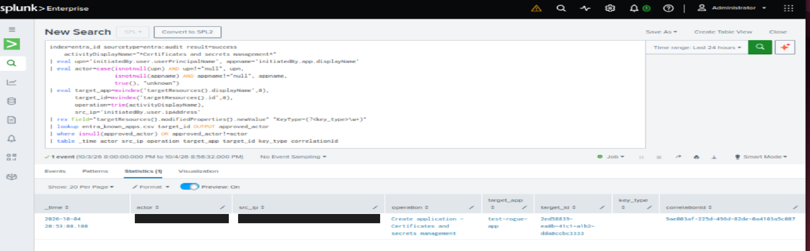
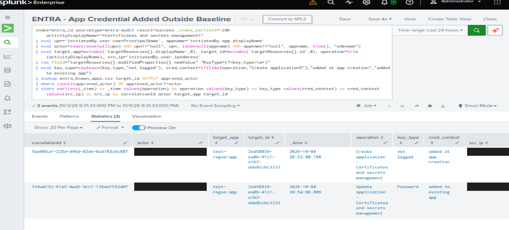
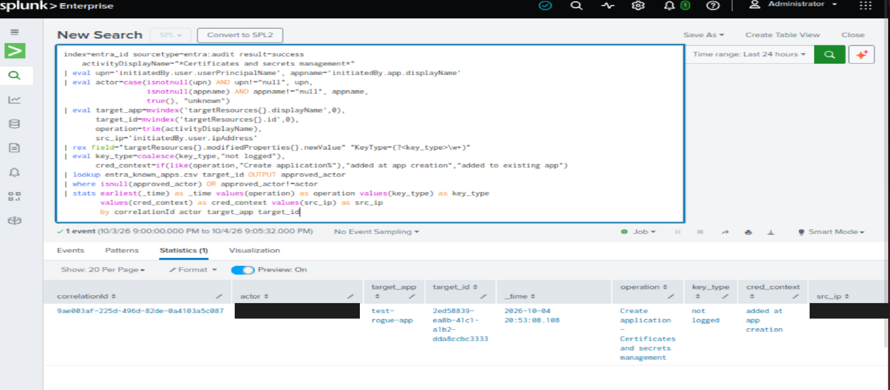
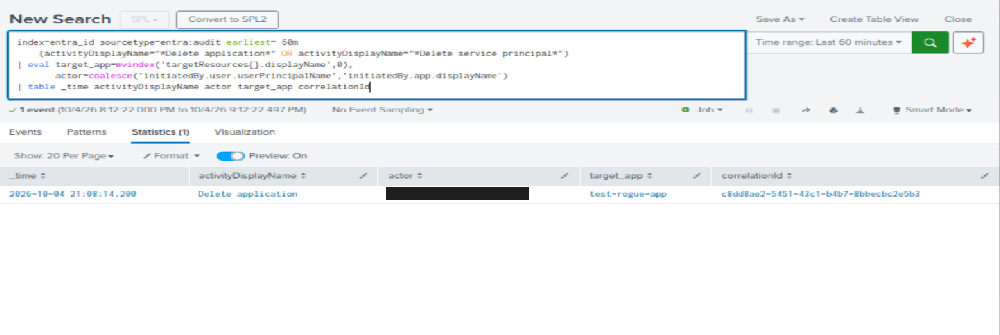
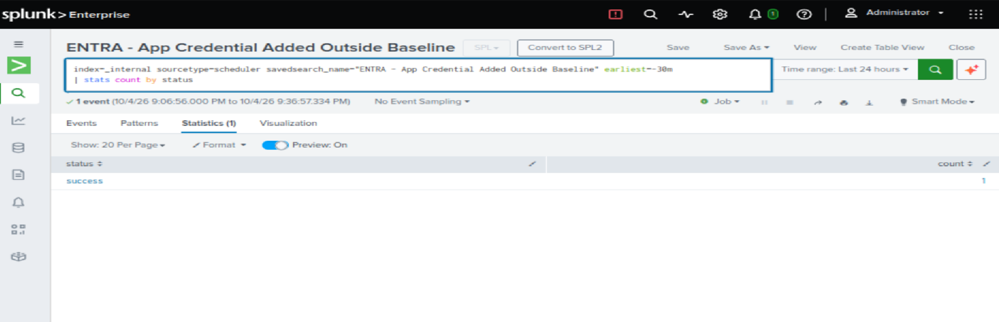

# Entra ID Identity Monitoring (Splunk, detection-as-code)

Pulls Microsoft Entra ID audit logs into Splunk via Microsoft Graph and detects
persistence via app registration credentials. Built on the Entra ID Free tier
as a lab mirror of production cloud-identity monitoring.

## Summary
- Ingest: Graph `auditLogs/directoryAudits` pulled every 15 min by a systemd timer
- Store: Splunk index `entra_id`, sourcetype `entra:audit` (JSON, indexed extractions)
- Detect: secret/certificate added to an app registration by an actor outside a baseline
- Sign-in logs (`entra:signin`) are wired up but need Entra P1/P2 (Graph returns 403 on Free)

## Architecture
Entra ID -> Graph API (client-credentials, AuditLog.Read.All) -> entra_pull.py
-> /var/log/entra/*.json -> Splunk monitor input -> index entra_id -> scheduled alert

| Component | Detail |
|---|---|
| `entra_pull.py` | Token via client credentials, `$filter` on timestamp checkpoint, appends JSON lines |
| systemd service + timer | Oneshot, 15-min cadence, secrets read from a root-owned env file outside the repo |
| Splunk inputs | Monitor with `crcSalt = <SOURCE>`, `INDEXED_EXTRACTIONS = json`, `KV_MODE = none` |
| Lookup | `entra_known_apps.csv` (`target_id`, `approved_actor`) as the approved-change baseline |
| Logrotate | Weekly, 4 kept, `copytruncate` |

## Detection: App Credential Added Outside Baseline
- Logic: `detections/entra_app_credential_added.spl`
- Alert definition: `detections/savedsearches.conf` (every 15 min, filters on `_index_earliest=-35m`, suppresses by `correlationId` for 24h)
- Output fields: actor, source IP, target app, `key_type`, `cred_context` (created with the app vs added to an existing app)

### Validation
| Case | Expected | Result |
|---|---|---|
| Baseline log-reader app secret | No alert | 0 rows |
| `test-rogue-app` created with a secret | Alert | 1 row, `key_type` not logged |
| Secret added to `test-rogue-app` afterwards | Alert | 1 row, `key_type=Password` |

Evidence screenshots are in `docs/`.

## Data quality notes
- `activityDisplayName` can carry trailing whitespace; the search wildcards both ends and uses `trim()`.
- Some JSON nulls arrive as the literal string `"null"`; actor logic guards for it.
- Create-application events carry no `KeyType`; the search reports "not logged" instead of a blank.
- Entra audit events appear 2 to 30 minutes late. The alert filters on index time so late events are still caught.
- Free-tier retention is 7 days, so the pull script's first run backfills 6 days.

## Limitations and risks
- Allowlisting on actor + app would suppress a compromised admin rotating the log-reader secret. Mitigations: change-window or ticket check, and sign-in anomaly detection once P1/P2 data is available.
- Checkpoint uses `gt`, so an event sharing the exact checkpoint timestamp could be skipped.
- One rogue-app credential add produces one alert per event (Create and Update have different correlation IDs).

## Framework mapping
MITRE ATT&CK T1098.001 (Account Manipulation: Additional Cloud Credentials); NIST 800-53 AC-2, AU-6; CIS Controls 5 and 8.

## Setup
1. Register an app with Application permissions `AuditLog.Read.All` and `Directory.Read.All`, then grant admin consent.
2. Copy `.env.example` to `/etc/entra-pull.env` (root-owned, mode 640) and fill in the values.
3. Install the systemd service and timer, create the `entra_id` index, and add the monitor inputs and props.
4. Copy `lookups/entra_known_apps.csv.example`, replace the placeholders, and place it in the Splunk app's `lookups/` folder.
5. Deploy `detections/savedsearches.conf` to the app's `local/` folder.

## Roadmap
- More audit-based detections: consent and app-role grants, user create/delete, password reset, MFA method changes
- Sign-in detections (T1078) once P2 trial data is available
- Add-on C04: Terraform and Checkov scanning for the Entra configuration

## Evidence
Screenshots have the account email and source IP redacted.

| Step | Screenshot |
|---|---|
| First detection hit (raw, pre-merge) |  |
| Final detection: rogue app, secret at creation and added afterwards |  |
| Final detection: create-time event |  |
| Cleanup: Delete application event (next detection candidate) |  |
| Scheduled alert running every 15 min |  |

## Alert configuration repair (C05-ALERTS-01)

The count trigger uses counttype/relation/quantity and per-result mode for 24-hour correlationId suppression. Detection SPL and schedule are unchanged. See [validation and operational notes](docs/c05-alerts-01-validation.md) and [evidence](docs/evidence/c05-alerts-01/).

## Permission-grant detection (C05-DETECT-02)

Detection 2 compares successful Entra app-role and delegated grants with an explicit five-field baseline. It separates delegated scopes, retains malformed events as parsing errors, and uses per-event/per-permission suppression with local-only alert tracking. See [validation and reproducibility](docs/c05-detect-02-validation.md), [production SPL](detections/c05_permission_grants.spl), and [acceptance evidence](docs/evidence/c05-detect-02/acceptance.json). This lab validation does not establish fresh tenant ingestion or complete the separately scoped Premium-dependent sign-in work.

## Free-tier collector hardening (C05-COLLECT-01)

Audit-only collection with 24-hour overlap, event-ID deduplication, bounded retries and durable checkpoints. Premium sign-in work is deferred. See docs/c05-collect-01-validation.md for tests and recovery limits. Deployed and validated; independent review pending. Live checks returned zero new records and do not establish fresh end-to-end ingestion.
